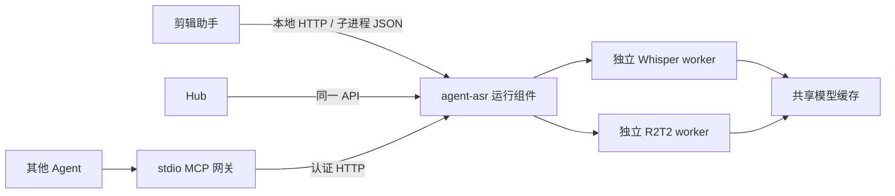

# agent-asr

供桌面应用和 Agent 复用的本地语音转文字组件。支持 **faster-whisper small、faster-whisper large-v3、网易有道 R2T2**，提供统一转写结果、模型对比、独立后台进程、异步 HTTP API 和可选 MCP 接口。

它是一个可独立安装和升级的运行组件，不是需要用户另开窗口的第三个桌面软件。剪辑助手与 Hub 可以各自启动它，也可以复用同机已经运行的服务。两个应用接入代码尚不在本仓库中。

> 当前 v0.1.1 提供 Python wheel 和源码包，需要 Python 与后端依赖；音频预处理使用 PyAV，无需单独安装 FFmpeg 命令行程序。**不包含 Python 解释器、模型权重或一键运行的 EXE**。应用内自动下载、自动切换版本和预装完整运行环境需要由宿主实现；本组件提供稳定 API、发布清单与安装校验脚本作为接入基础。

## 为什么独立出来

- 一处维护模型适配，多个应用复用。
- 模型推理不阻塞 Electron 主进程。
- 更新语音组件不需要重新构建宿主应用，前提是 API 主版本保持兼容。
- 模型权重使用共享缓存，两个应用无需各下载一份。
- Whisper 和 R2T2 可以分别装在独立环境，避免 PyTorch、Transformers 等依赖互相影响。
- 将中文识别结果、速度和资源使用放在同一份报告中比较，不把模型热度当成准确率。



## 已实现的功能与边界

| 功能 | v0.1.1 |
|---|---|
| Whisper small / large-v3 | faster-whisper，CPU INT8 或 CUDA |
| R2T2 离线转写 | R2T2 权重 + 官方 Qwen3ASRModel Transformers 接口 |
| R2T2 字词时间戳 | 可选 Qwen3-ForcedAligner-0.6B；默认开启 |
| 本地音频、视频输入 | PyAV 按帧提取 16 kHz 单声道 PCM，无外部 FFmpeg 进程 |
| 模型对比 | 顺序运行、文本差异、CER、耗时、进程 RSS |
| 后台服务 | SQLite 队列、查询、取消、重启恢复排队任务 |
| 模型环境隔离 | 支持分别指定 Whisper / R2T2 的 Python |
| MCP | 官方 Python MCP SDK，stdio 网关 |
| 独立更新基础 | wheel、sdist、版本清单、SHA-256 和新目录安装脚本 |
| 实时流式麦克风识别 | 未实现；当前聚焦文件转写与剪辑场景 |
| 自动下载并切换运行组件 | 宿主负责，当前不提供自动更新器 |
| GGUF / llama.cpp R2T2 | 未实现；当前 CPU 使用 FP32，不是低内存量化版 |

R2T2 官方离线 `transcribe` 直接继承 Qwen3ASRModel。本组件用该接口加载 **R2T2 checkpoint**，避免安装官方 R2T2 包默认引入的 vLLM。没有把 Qwen3-ASR 自身的权重冒充 R2T2，也没有实现或承诺 R2T2 的流式低延迟能力。

## 环境要求

- Python 3.11+，推荐 3.12；本次开发验证环境是 Windows x64 / Python 3.12。
- PyAV 随核心包安装。常见平台的预编译 wheel 自带 FFmpeg 库，无需安装 `ffmpeg.exe`；若平台没有适用 wheel，源码构建仍需要 FFmpeg 开发库。
- Whisper CPU 可使用 INT8；CUDA 运行需要与 CTranslate2 匹配的 NVIDIA CUDA / cuDNN。
- R2T2 CPU 采用 FP32，模型和对齐器内存占用较高。不要把 GGUF 的模型大小或苹果 M3 的速度套用到此后端。
- 首次下载需要访问 Hugging Face；全部模型已缓存后可以设置 `offline: true`。
- Linux/macOS 的代码路径已提供，但首版不宣称已完成这些平台的实机验收。

### 音频解码与时间戳

Whisper 和 R2T2 共用 PyAV 预处理：选择第一个音轨，按帧解码并重采样为 16 kHz 单声道 PCM16 WAV。尾部重采样缓冲会完整写出；预处理不将整个长音频加载到内存，但模型推理仍有自身的内存开销。无音轨、空音频或解码失败会返回错误。

转写时间戳相对于解码音频的起点，从零开始；不保留容器的绝对 PTS 偏移，不会按 PTS 跳变补静音。对于有音视频起始偏移或录制中断的素材，宿主应单独处理容器时间轴映射，不能直接假定与视频 PTS 完全相同。

`AGENT_ASR_FFMPEG` 自 v0.1.1 起不再使用。剪辑助手中的剪切、拼接、字幕烧录等操作仍可使用 FFmpeg 命令行，与本组件独立。替换解码方式本身不代表识别准确率提升。

## 安装

### 开发安装

Windows PowerShell：

```powershell
git clone https://github.com/anpy-j/agent-asr.git
cd agent-asr
python -m venv .venv
./.venv/Scripts/python.exe -m pip install -e ".[whisper,dev]"
./.venv/Scripts/python.exe -m agent_asr --version
./.venv/Scripts/python.exe -m agent_asr models
```

Linux/macOS 将 Python 路径替换成 `.venv/bin/python`。未选择可选后端时，安装核心包不会自动安装或加载神经网络模型。

### 从 GitHub 指定版本依赖

```powershell
python -m pip install "agent-asr[whisper] @ git+https://github.com/anpy-j/agent-asr.git@v0.1.1"
```

也可以下载 [GitHub Releases](https://github.com/anpy-j/agent-asr/releases) 中的 wheel：

```powershell
python -m pip install "./agent_asr-0.1.1-py3-none-any.whl[whisper]"
```

开发应用应固定 tag 或 commit，避免依赖浮动的 `main`。普通依赖打入应用后不会因为 GitHub 更新而自动升级；想独立更新，请采用后面的独立运行环境方式。

### R2T2 使用独立环境

```powershell
python -m venv .venv-r2t2
./.venv-r2t2/Scripts/python.exe -m pip install -e ".[r2t2]"
$env:AGENT_ASR_R2T2_PYTHON = (Resolve-Path './.venv-r2t2/Scripts/python.exe').Path
```

然后使用主环境运行 `run`、`compare` 或 `serve`。R2T2 worker 会使用上面指定的解释器；**那个环境也必须安装相同 API 主版本的 agent-asr**。只把 Python 路径指过去但没有安装组件，会得到明确的 worker 错误。

`qwen-asr` 自带的依赖较多，包括某些语言的分词与 UI 库；即便只处理中文，首次安装也可能较久。CUDA 环境应先按 [PyTorch 官方说明](https://pytorch.org/get-started/locally/)安装适配显卡的 wheel。当前没有自动安装 GPU 驱动或修改系统环境的功能。

R2T2 extra 固定 `qwen-asr==0.0.6`，并限制 `gradio<6`，避免上游固定 Transformers 4.57.6 与新版 Gradio 的 Hugging Face Hub 依赖冲突导致长时间回溯。

## 模型 ID 与下载

| ID | 权重来源 | 字词时间戳 |
|---|---|---|
| `whisper-small` | `Systran/faster-whisper-small` | Whisper 原生 |
| `whisper-large-v3` | `Systran/faster-whisper-large-v3` | Whisper 原生 |
| `r2t2` | `netease-youdao/Confucius4-R2T2` | Qwen3 强制对齐器 |

`small` / `large-v3` 是对应 Whisper ID 的别名。

```powershell
./.venv/Scripts/python.exe -m agent_asr download whisper-small
./.venv/Scripts/python.exe -m agent_asr download whisper-large-v3
./.venv-r2t2/Scripts/python.exe -m agent_asr download r2t2 --aligner
```

下载命令依赖 `huggingface-hub`，安装任一模型 extra 会带上它。可通过 `--revision COMMIT_SHA` 固定识别模型版本；请求中的 `aligner_revision` 可以独立固定对齐器版本。首次下载日志属于正常情况，不计为纯推理速度。

默认数据目录：

- Windows：`%LOCALAPPDATA%/agent-asr`
- Linux/macOS：`$XDG_DATA_HOME/agent-asr`，未设置时为 `~/.local/share/agent-asr`
- 设置 `AGENT_ASR_HOME` 可覆盖目录。

权重缓存位于数据目录的 `models/`。缓存采用 Hugging Face snapshot 格式，不自动删除旧版本。响应包含实际 snapshot 路径，便于追溯。自定义 `model_path` 可指向已经下载的后端格式目录；Whisper 必须是 CTranslate2 格式，不能直接使用原始 PyTorch 权重。

## 单次转写

复制 `examples/transcribe.json`，把 `source` 改成本机实际文件的**绝对路径**：

```json
{
  "source": "D:/videos/sample.mp4",
  "model": "whisper-small",
  "language": "zh",
  "device": "cpu",
  "word_timestamps": true,
  "context": "女装，羊绒，醋酸面料，尺码"
}
```

```powershell
./.venv/Scripts/python.exe -m agent_asr run --request examples/transcribe.json --output data/transcript.json
```

常用请求字段：

| 字段 | 默认值 / 含义 |
|---|---|
| `source` | 必填，本机存在的音视频文件 |
| `model` | `whisper-small` |
| `language` | `zh`；`null` 自动检测，其他语言按后端支持情况 |
| `device` | `cpu` 或 `cuda` |
| `compute_type` | Whisper CPU 默认 `int8`，R2T2 CPU 默认 `float32`；CUDA 默认 `float16` |
| `word_timestamps` | `true`，剪辑接入建议保留 |
| `context` | 热词或背景提示；两个后端的提示机制并不完全相同 |
| `beam_size` | Whisper 默认 5；R2T2 不使用这个参数 |
| `cpu_threads` | 0 表示自动：逻辑 CPU 数减 2，最少 1 |
| `model_path` | 可选，本地模型目录 |
| `revision` | 可选，识别模型的 Hugging Face revision |
| `aligner` | R2T2 默认 `Qwen/Qwen3-ForcedAligner-0.6B`，也可用本地目录 |
| `aligner_revision` | 可选，对齐器 revision |
| `offline` | 默认 `false`，设为 `true` 后缓存缺失直接报错 |

输入按字段严格校验，不接受拼错的字段。未知模型或缺失文件在模型加载前报错。

### 输出约定

```json
{
  "api_version": 1,
  "component_version": "0.1.1",
  "model": "whisper-small",
  "backend": "faster-whisper",
  "text": "这件外套采用羊绒面料。",
  "duration": 12.5,
  "timestamp_source": "whisper",
  "segments": [{"start": 1.2, "end": 4.8, "text": "这件外套采用羊绒面料。"}],
  "words": [{"start": 1.2, "end": 1.5, "text": "这件"}],
  "metrics": {"total_seconds": 8.2, "inference_seconds": 7.1, "rtf": 0.568}
}
```

上例仅展示结构，时间和文本为示意值。完整结果还记录源文件 SHA-256、请求参数、依赖版本、实际模型路径和 worker RSS。

- 所有时间均为秒，基于**传入媒体文件的时间轴**，不含剪辑草稿时间线换算。
- `segments` 是后端分段，不保证是完整、带标点的句子。R2T2 当前返回一个完整对齐结果跨度；宿主负责句子切分。
- R2T2 强制对齐的 tokens 可能不带标点，不能用 `words` 拼接替代原始 `text`。
- 关闭 R2T2 `word_timestamps` 后仅返回文本，`segments` / `words` 为空，`timestamp_source` 为 `none`。
- 请求字词时间戳但非空文本没有对齐结果时会失败，不按字数均分虚构时间戳。
- 空音频转写可以是空文本；剪辑助手可根据业务进一步拒绝。

Python API 也可直接使用：

```python
from agent_asr import transcribe

result = transcribe({"source": "D:/videos/sample.mp4", "model": "whisper-small"})
```

直接 Python API 在当前进程中加载模型。桌面应用优先使用 `run` 或 HTTP 服务，得到隔离和取消能力。

## 三模型对比

修改 `examples/compare.json` 中的路径和人工校对稿：

```powershell
./.venv/Scripts/python.exe -m agent_asr compare --request examples/compare.json --output data/comparison.json
```

报告包含每个模型的原始转写、耗时、RTF、峰值 worker RSS、两两文字差异，以及有参考稿时的 CER。

不同模型的本地权重路径或计算精度可通过 `model_overrides` 分别设置，例如 `"model_overrides": {"r2t2": {"compute_type": "float32", "model_path": "D:/models/R2T2"}}`。键必须是当前 `models` 列表中的规范 ID。多模型比较禁止共用一个 `model_path`，避免把同一权重误标成不同模型；覆写不能改变素材、语言或上下文提示。

**没有人工校对稿时删除 `reference_text`，报告只显示差异，不判断哪个模型更准确。** 不把其中一个模型输出当真值。一个模型失败时仍然保存其他模型的结果和失败原因，命令退出码为 2。

CER = 字符级 Levenshtein 编辑距离 / 参考稿字符数。包含替换、漏字和多字，可以大于 100%。默认执行 NFKC、转小写、忽略空白及标点；**不自动繁简转换，不把中文数字转阿拉伯数字**。`ignore_digits: true` 会移除阿拉伯数字及中文数字字符，属于额外诊断口径，不能用它掩盖尺码、价格等真实错误。

建议准备包含品牌、面料、尺码、价格、背景音乐、口音与静音的短素材，逐字人工校对后比较。相同设备、相同输入、相同上下文提示下顺序运行。不要仅看总体 CER，价格与商品名即便只错一个字也可能很重要。

指标说明：

- `total_seconds`：包含权重解析/首次下载、音频解码、模型冷加载、推理、输出归一化和源文件指纹计算。
- `inference_seconds`：包含模型初始化以及后端推理；不是预热后的纯神经网络前向时间。
- `rtf`：`inference_seconds / duration`，小于 1 表示这一阶段比音频时长短。
- `peak_worker_tree_rss_bytes`：每 100 ms 采样识别 worker 及其全部子进程的 RSS 总和，包含 PyAV 解码和 Windows venv 实际 Python 子进程；**不含 GPU 显存**，共享内存可能被重复计算，不等同于独占内存。
- 默认每模型单独进程，结束后释放模型；不会同时加载三个模型。
- 单模型默认超时 7200 秒；比较请求可以用 `timeout` 设置 1–86400 秒。

## 后台 HTTP 服务

```powershell
./.venv/Scripts/python.exe -m agent_asr serve --port 8766
```

只监听 `127.0.0.1`。第一次启动会在数据目录创建 `service.token`，除 `/health` 外的接口都要求 `Authorization: Bearer TOKEN`。也可以通过 `AGENT_ASR_TOKEN`（至少 24 个字符）或 `--token-file` 指定令牌。令牌只供本机应用使用，不放进 Git、截图或公开日志。

| 方法 | 路径 | 功能 |
|---|---|---|
| GET | `/health` | 无需认证的最小版本信息 |
| GET | `/v1/models` | 模型列表与当前服务 Python 的依赖状态 |
| POST | `/v1/transcriptions` | 请求内容为单次转写 JSON；返回 202 和任务 ID |
| POST | `/v1/comparisons` | 请求内容为比较 JSON；返回 202 和任务 ID |
| GET | `/v1/jobs/{id}` | 任务状态、时间、日志和结果路径 |
| GET | `/v1/jobs/{id}/result` | 成功结果或已完成的部分比较报告 |
| POST | `/v1/jobs/{id}/cancel` | 请求体 `{}`；取消排队/运行任务 |

任务状态：`queued → running → succeeded / failed / cancelled`。`failed` 的比较任务可能仍有部分报告。服务重启将中断的 `running` 标记失败，保留 `queued`，不悄悄重跑已经开始的任务。同一个数据目录只允许一个队列服务持有锁。

队列不会报告虚构的百分比进度，目前仅提供任务状态和日志。取消会终止该任务的 worker 及其子进程；服务自身和其他排队任务继续存在。

### Python 客户端

```python
import time
from pathlib import Path
from agent_asr.client import Client
from agent_asr.models import data_dir

token = (data_dir() / "service.token").read_text(encoding="utf-8").strip()
client = Client(token)
job = client.transcribe({"source": "D:/videos/sample.mp4", "model": "whisper-small"})
while True:
    state = client.job(job["id"])
    if state["status"] not in {"queued", "running"}:
        break
    time.sleep(1)
if state["status"] == "succeeded":
    result = client.result(job["id"])
else:
    raise RuntimeError(state)
```

Electron/Node 应用可用 `fetch` 调用相同 HTTP 接口；通过 `spawn` 启动版本目录中的 Python，参数为 `-m agent_asr serve --port 8766`。宿主应先检查 `/health` 的 `api_version`，已有兼容服务则复用；关闭应用只终止自己启动的服务，不终止其他应用持有的服务。

HTTP API 操作的是服务所在机器的文件，没有远程文件上传功能。令牌持有者能请求本机文件转写，因此只向可信宿主提供令牌。不开放公网访问、不接受客户端提供的解释器路径或任意 Python 插件代码。

## MCP 接入

MCP 是可选 **stdio 网关**，复用上面的 HTTP 服务，并非另一个模型进程或 HTTP Streamable MCP 服务。先启动 `serve`，再启动 MCP 网关：

```powershell
./.venv/Scripts/python.exe -m pip install -e ".[mcp]"
./.venv/Scripts/python.exe -m agent_asr mcp
```

工具：`list_asr_models`、`create_transcription`、`compare_transcriptions`、`get_transcription`、`cancel_transcription`。

客户端配置示例（替换绝对路径）：

```json
{
  "mcpServers": {
    "agent-asr": {
      "command": "D:/develop/ai/project/agent-asr/.venv/Scripts/python.exe",
      "args": ["-m", "agent_asr", "mcp"],
      "env": {
        "AGENT_ASR_URL": "http://127.0.0.1:8766",
        "AGENT_ASR_TOKEN_FILE": "C:/Users/YOUR_NAME/AppData/Local/agent-asr/service.token"
      }
    }
  }
}
```

`create_transcription` 的参数是 `{"request": {"source": "...", "model": "whisper-small"}}`。`compare_transcriptions` 同样接收 `request`，其内容为完整比较 JSON。`get_transcription` 接收 `job_id` 与可选的 `include_result: true`。

## 独立更新与回退

1. 下载固定版本的 wheel、`manifest.json`、`SHA256SUMS.txt`。生产宿主应从可信仓库读取发布清单，并核对 API 主版本和 SHA-256。
2. 在新版本目录创建环境，安装组件和需要的 backend；不覆盖运行中的环境。
3. 执行 `--version`、`models` 和短音频验收，确认服务 API 兼容。
4. 等当前转写结束后，让宿主配置指向新版本的 Python，再启动新服务。
5. 保留旧版本目录，失败时切回旧解释器即可；模型缓存继续共用。

Windows 安装辅助脚本：

```powershell
./scripts/install_component.ps1 `
  -Wheel './agent_asr-0.1.1-py3-none-any.whl' `
  -Sha256 '从可信 SHA256SUMS.txt 复制该 wheel 的哈希' `
  -Destination "$env:LOCALAPPDATA/agent-asr/runtime/0.1.1-whisper" `
  -Backend whisper
```

R2T2 可安装到另一个目录，设置 `AGENT_ASR_R2T2_PYTHON`。脚本执行哈希校验、创建全新 venv、安装和版本检查，不替宿主自动切换版本。它仍需可用的 Python 与依赖下载网络；wheel 的哈希并不意味着第三方依赖已经完全离线封装。

新增模型分两类：已有 adapter 换兼容权重只需下载并设置 `model_path`；新的推理框架需要发布新的组件版本及其环境依赖。只要 `/v1` 和结果契约保持兼容，宿主不需要重新打包。实际的自动更新按钮和流程不在首版范围内。

## 环境变量

| 变量 | 用途 |
|---|---|
| `AGENT_ASR_HOME` | 数据、任务及模型缓存根目录 |
| `AGENT_ASR_WHISPER_PYTHON` | Whisper worker 的 Python |
| `AGENT_ASR_R2T2_PYTHON` | R2T2 worker 的 Python |
| `AGENT_ASR_TOKEN` | 服务和客户端令牌 |
| `AGENT_ASR_TOKEN_FILE` | MCP 网关读取令牌的位置 |
| `AGENT_ASR_URL` | MCP 网关连接的 loopback HTTP 地址 |

`serve --data-dir` 只改变队列/令牌目录，模型缓存仍由 `AGENT_ASR_HOME` 决定。所有 worker 继承服务启动时的环境变量。

## 测试与发布构建

```powershell
./.venv/Scripts/python.exe -m pytest -q
./.venv/Scripts/python.exe scripts/build_release.py
```

`dist/` 产物：wheel、源码 tar.gz、安装辅助脚本、manifest、SHA256SUMS。构建脚本只对当前版本明确命名的产物生成清单，源码包不包含模型、素材、数据库或 token。

测试覆盖请求校验、CER、比较失败处理、两个后端的参数和输出映射、真实子进程队列、PyAV 音频准备、重采样及 MP4/AAC 解码、HTTP 认证和结果查询、运行/排队取消及同目录服务锁。神经模型映射测试使用模拟后端；**通过这些测试不代表已经完成三个大模型的真实音频准确率评测**。实机验证记录见 [验证说明](docs/validation.md)。

## 项目结构

```text
src/agent_asr/
  core.py           音频准备、Whisper/R2T2 离线适配
  schema.py         输入与时间戳校验
  models.py         模型注册表、共享目录
  runner.py         进程隔离、资源采样、模型对比
  metrics.py        CER 与文本差异
  jobs.py           SQLite 队列与进程树取消
  server.py         loopback HTTP API
  client.py         无额外 HTTP 依赖的 Python 客户端
  mcp_server.py     可选 stdio MCP 网关
  cli.py            命令行入口
examples/           转写、比较请求示例
scripts/            构建与独立安装脚本
tests/              契约和服务测试
```

## 已知限制与后续接入

- 当前组件已经与两个宿主解耦，但**尚未修改 Hub 或剪辑助手**。
- 剪辑助手接入时应集中替换编辑器、原切片管线和 V3 的 ASR 调用；视频时间线映射和女装业务规则仍由剪辑助手负责。
- 首版没有字幕编辑 UI、模型对比 UI、自动词表纠错、说话人分离或自动百分比进度。
- R2T2 的中文实际错字率、速度与切点精度，需要在真实直播素材上验证。不同量化档、解码设置、提示和分段方式都会影响结果。
- 依赖状态只检测当前 Python 模块，不等于权重已下载、显卡可用或外部 worker 已通过验收。
- 服务仅供可信本机应用使用，暂不提供多用户权限或网络部署。

## 许可证与上游来源

本仓库原创代码采用 [MIT](LICENSE)。模型及第三方库遵循各自许可证，MIT 不覆盖模型权重。

- [faster-whisper](https://github.com/SYSTRAN/faster-whisper)：推理实现与运行说明。
- [Whisper](https://github.com/openai/whisper)：模型来源。
- [网易有道 R2T2](https://github.com/netease-youdao/Confucius4-R2T2)：代码采用 Apache-2.0，权重采用 NetEase Model Use License Agreement。
- [R2T2 权重](https://huggingface.co/netease-youdao/Confucius4-R2T2)。
- [Qwen3-ASR](https://github.com/QwenLM/Qwen3-ASR)与 [Qwen3-ForcedAligner](https://huggingface.co/Qwen/Qwen3-ForcedAligner-0.6B)。

本仓库不复制或再分发模型权重。商业产品分发模型前，应按实际使用方式核对上游权重许可证。
